# Fruit

> [!IMPORTANT]
> Fruit has been removed from the main Homebrew repository. Homebrew now requires every cask to be signed with an Apple Developer ID and notarized by Apple, which means paying Apple for a developer account. The developer of this project won't comply with that rule, so Fruit is now distributed through its own tap:
>
> ```bash
> brew tap corkscrews/tap
> brew trust corkscrews/tap
> brew install --cask corkscrews/tap/fruit-screensaver
> ```
>
> If you installed it from the main repository before, uninstall that copy first with `brew uninstall --cask fruit-screensaver`.

<a href="https://github.com/Corkscrews/fruit/actions/workflows/tests.yml"></a>
<a href="https://github.com/Corkscrews/fruit/releases/latest"></a>

A macOS screensaver of the vintage 🍎 logo, drawn with `NSBezierPath` masks in Swift and filled by Metal shaders, with EDR support.

Compatible with macOS 11.5 and later.

<p align="center">
  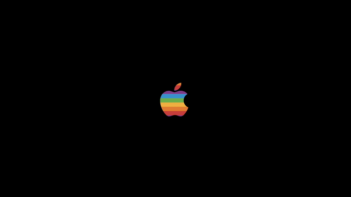
</p>

## Install

### Homebrew (recommended)

Fruit is available from the [Corkscrews tap](https://github.com/Corkscrews/homebrew-tap):

```bash
brew tap corkscrews/tap
brew trust corkscrews/tap  # Homebrew only loads casks from taps you trust
brew install --cask corkscrews/tap/fruit-screensaver
```

Then open **System Settings → Screen Saver** and select **Fruit**.

The build is not notarized, so macOS may refuse to open it the first time. Clear the quarantine flag and select it again:

```bash
xattr -dr com.apple.quarantine ~/"Library/Screen Savers/Fruit.saver"
```

Update or remove it with:

```bash
brew upgrade --cask fruit-screensaver
brew uninstall --cask --zap fruit-screensaver
```

### Manual download

1. [Download the latest Fruit.saver.tar.gz](https://github.com/Corkscrews/fruit/releases/latest/download/Fruit.saver.tar.gz) and extract it.
2. Double-click **Fruit.saver** to install it.
3. If macOS says it is from an unidentified developer, press **OK**, open **System Settings → Privacy & Security**, and press **Open Anyway** next to the Fruit message. If that does not work, run the `xattr` command above.

### Build from source

1. Clone the project.
2. Run `bash .github/scripts/build.sh --install`, or open `Fruit.xcodeproj`, select the `Fruit` target and **Archive** it.
3. If you archived it, right-click the `.xcarchive`, select **Show Package Contents**, open `Products` until you find `Fruit.saver`, and double-click it.
4. Select **Fruit** in the Screen Saver settings.

## Backgrounds

Pick a background in **System Settings → Screen Saver → Options…**, or choose **Random** to switch to a new one every minute.

| | Background | Description |
|:-:|---|---|
| 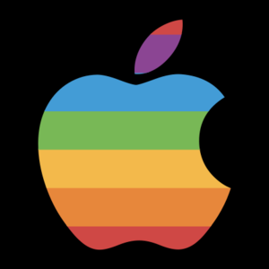 | **Rainbow Bars** | The classic six-color stripes, scrolling slowly up through the logo. This is the original animation, the one that gave me the idea for this project, and I am infinitely grateful for it. |
|  | **Solid** | One flat color that fades through the rainbow palette. |
| 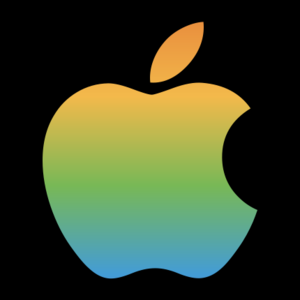 | **Linear Gradient** | A top-to-bottom gradient of the rainbow colors that shifts over time. |
| 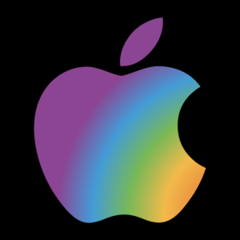 | **Circular Gradient** | A radial gradient of the rainbow colors that shifts over time. |
| 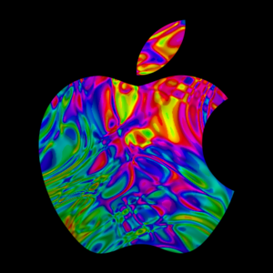 | **Psychedelic** | A bevelled fruit filled with warped plasma that swirls like a stirred drink, speeding up in short bursts. |
|  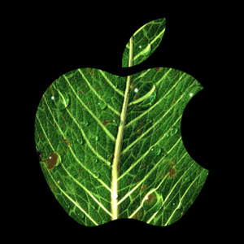<br>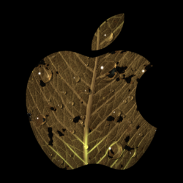 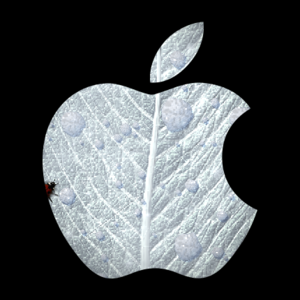 | **California** | A leaf with pulsing veins, dew drops and a wandering ladybird. Day/night and the season follow your clock; shown at midday in spring, summer, fall and winter. |
| 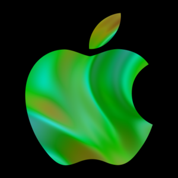 | **Liquid** | Smooth, layered domain-warped flow with soft color bands. |
| 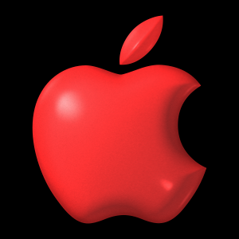 | **Puppy** | A glossy, softly glowing 3D logo lit by a lamp that orbits it and slowly changes hue. |
| 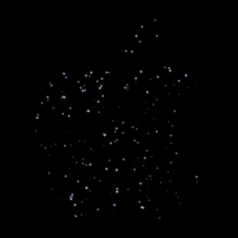 | **Warp Speed** | A relativistic star field that starts at rest; as the ship speeds up, stars stretch into streaks, shift color and crowd the center. |
| 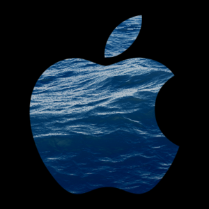 | **Irish Ocean** | A dark North Atlantic sea with rolling waves, foam and spray. |
| 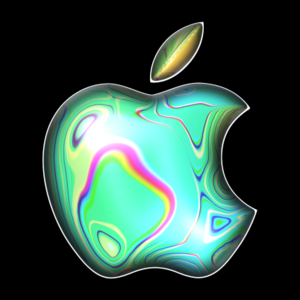 | **Glass** | A thick glass slab over polarized-light rainbow fringes. |
| 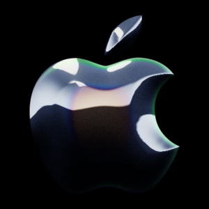 | **Metallic** | A liquid-metal surface reflecting a studio environment. |
| 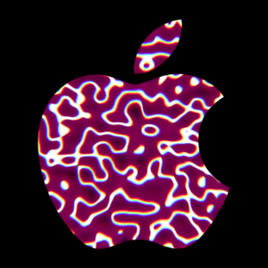 | **POGO** | Organic, Turing-like patterns that crawl and reshape. |
| 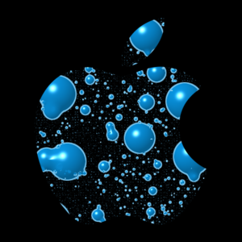 | **Glue** | Glossy blobs that drift and merge like drops of glue. |
| 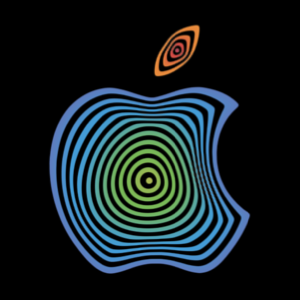 | **Bands** | Rainbow rings grow from the middle of the fruit and the leaf, bending into their outlines as they expand. |

*New designs are welcome through PRs!*

<p align="center">
  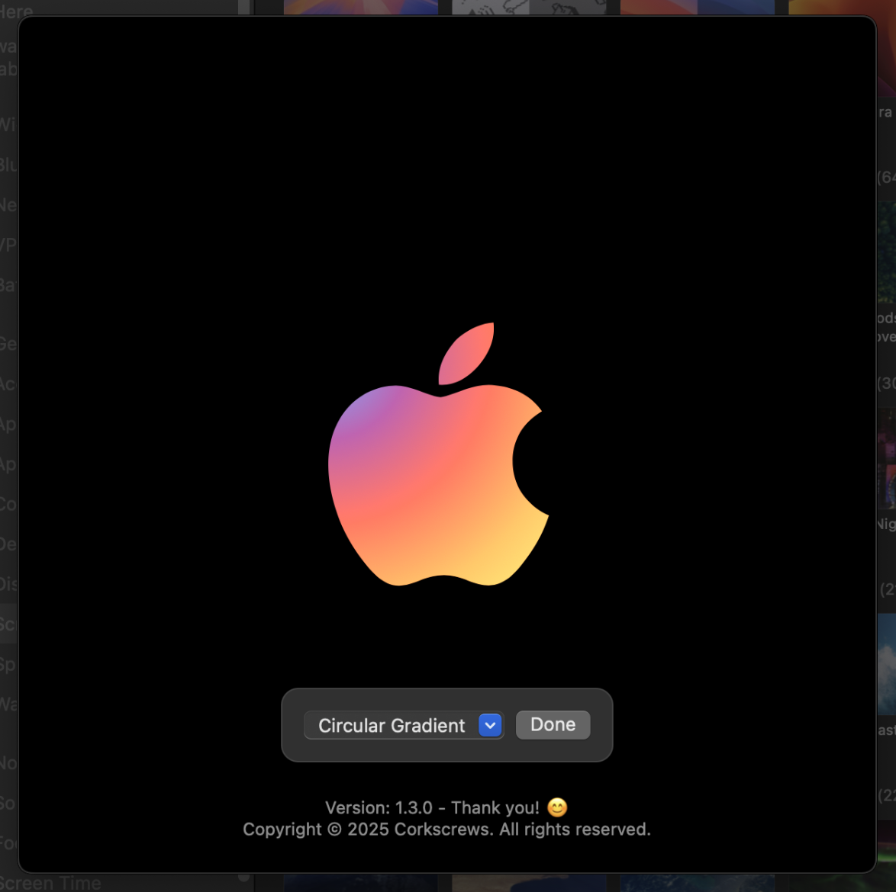
</p>

## Troubleshooting 🤕

### Black screen or old version after an update

macOS caches the screensaver binary in `legacyScreenSaver.appex` and (on Sequoia) in `WallpaperAgent`. Copying a new `.saver` over the old one does **not** work: `cp -R` merges directories and the stale binary persists, even across reboots. When building from source, use the build script to replace it cleanly:

```bash
bash .github/scripts/build.sh --install
```

To do it by hand:

1. Select any other screen saver in **System Settings**.
2. Force quit every `legacyScreenSaver` process in **Activity Monitor**.
3. Delete `~/Library/Screen Savers/Fruit.saver` (`rm -rf`, not a copy over it).
4. Quit **System Settings**, install the new build, and clear its quarantine flag.

See [Docs/macOS-Screensaver-Install-Cache-Bug.md](Docs/macOS-Screensaver-Install-Cache-Bug.md) and [Docs/macOS-Sonoma-Screensaver-Issue.md](Docs/macOS-Sonoma-Screensaver-Issue.md) for details.

### Blocked as malicious software

If **Open Anyway** in **Privacy & Security** does not help, remove the quarantine flag:

```bash
xattr -dr com.apple.quarantine ~/"Library/Screen Savers/Fruit.saver"
```

Still stuck? [Open an issue](https://github.com/Corkscrews/fruit/issues) with your macOS version and Mac model.

## Special thanks

Thanks to [Márton Braun](https://github.com/zsmb13) for the article that helped fix the macOS Sonoma issues: https://zsmb.co/building-a-macos-screen-saver-in-kotlin. Thanks also to [pedrommcarrasco](https://github.com/pedrommcarrasco) for [Brooklyn](https://github.com/pedrommcarrasco/Brooklyn), which guided the development of this screensaver.

## License

Fruit is available under the MIT license. See the [LICENSE](LICENSE) file for more information. The POGO shader includes code ported from [SahilK-027/0x7444ff](https://github.com/SahilK-027/0x7444ff) (MIT). Logo & original animations are Apple's property.
